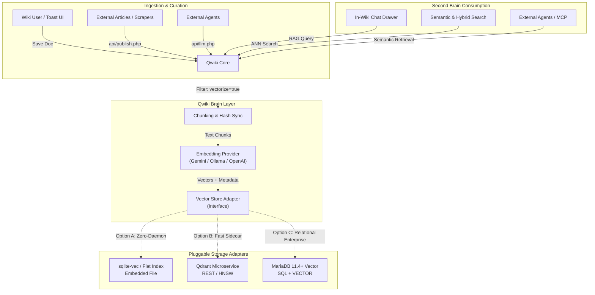

# Qwiki Transformation

Looking at your previous explorations—**MariaDB Vector Store Architecture** (relational + native vector functions) and **Open Source Vector Alternatives** (dedicated engines like Qdrant/Milvus, embedded options like `sqlite-vec`, and hybrid search engines)—here is an analysis of how this can be achieved, how to structure the architecture, and the short- and long-term implications.

---

### 1. Architectural Strategy: Reconciling Qwiki's DNA with Vector Engines

Standalone Qwiki's primary strength is its **zero-database, flat-file simplicity** (PHP + JSON + Markdown), subfolder-portability, and zero daemon requirements. Introducing vector operations introduces two needs:

1. **Embedding generation** (vector math / API calls).
2. **Nearest-Neighbor (ANN) Indexing & Retrieval** (HNSW, Cosine/Dot product).



#### Evaluating the Backend Choices for Qwiki

| Backend                        | Fit with Qwiki Philosophy                                                                               | Complexity & Hosting                                                                   | Best Use Case                                                             |
|:------------------------------ |:------------------------------------------------------------------------------------------------------- |:-------------------------------------------------------------------------------------- |:------------------------------------------------------------------------- |
| **`sqlite-vec` (Embedded)**    | **Highest**: In-process SQLite vector extension, flat file alongside `qwiki.json`. Zero server daemons. | Very Low. Runs inside PHP via `pdo_sqlite` or FFI.                                     | Individual, small team, personal second brain, zero-config distributions. |
| **Qdrant (Dedicated Sidecar)** | **Balanced**: Decoupled, single binary/Docker container, native payload filtering, rich REST API.       | Low-Medium. Requires running a Docker sidecar or connecting to Qdrant Cloud.           | Team/Org second brain, high volume of external articles, multi-tenant.    |
| **MariaDB 11.4+ Vector**       | **Selective**: Powerful SQL joins, ACID, but requires bleeding-edge MariaDB with Vector engine enabled. | High. Cannot run on standard shared LAMP hosts without modern MariaDB 11.4+ instances. | Organizations already standardizing on a MariaDB database cluster.        |

> **Recommended Pattern**: Implement an **Abstract Vector Store Adapter** inside Qwiki (`lib/Core/Vector/VectorStoreInterface.php`). 
> 
> - Default or portable mode: **`sqlite-vec`** (or a local JSON/binary index for small sets).
> - Scale/Org mode: **Qdrant** (via HTTP REST) or **MariaDB Vector** configured via `qwiki.json`.

---

### 2. Implementation: The 4 Functional Pillars

#### Pillar 1: Selective Article Vectorization (Wiki & API)

Not every scratchpad or utility page belongs in the vector index.

* **Document-Level Opt-In/Opt-Out**:
  * In the document editor (Toast UI / SunEditor), add a toggle: `[x] Index in Second Brain`.
  * Stored in `qwiki.json` as `"vectorize": true`.
  * Can be set at the Category level as a default (e.g., Category `Engineering KB` defaults to `true`; `Drafts` defaults to `false`).
* **API Ingestion**:
  * In `api/publish.php` and `api/admin.php`, accept a `"vectorize": true` parameter in JSON payloads.
* **Chunking & Invalidation Strategy**:
  * Markdown documents should be chunked using a **header-aware splitter** (`#`, `##`, `###`) with a sliding window (e.g., 500–800 tokens, 100-token overlap).
  * Chunks must carry metadata payloads: `doc_slug`, `title`, `category`, `mtime`, `chunk_index`, and `url`.
  * **Stale chunk eviction**: When saving an article, compute a content hash (`sha256`). If modified, delete all chunks matching `doc_slug` from the vector store before upserting the new chunks.

#### Pillar 2: External Article Summaries, Search & Hyperlinking

To act as a true organizational second brain, Qwiki must ingest knowledge that originated outside the wiki.

* **Storage Model for External Content**:
  * Treat external summaries as first-class or virtual documents. You can leverage Qwiki's existing `type: "remote"` or introduce a lightweight `type: "reference"` document:
    
    ```json
    {
      "id": "ext-arxiv-2403",
      "type": "reference",
      "title": "Scaling Laws for LLM Reasoning",
      "source_url": "https://arxiv.org/abs/...",
      "summary": "Key takeaways on inference compute scaling...",
      "vectorize": true
    }
    ```
* **Unified Semantic & Hybrid Search**:
  * Enhance Qwiki's search modal (`assets/js/app.js` + `api/search.php`). When a user searches, provide a toggle: `[Keyword] | [Semantic / Brain]`.
  * Results clearly distinguish internal vs external items with visual badges:
    - 📄 `Internal Article` ➔ opens `/category/slug`
    - 🌐 `External Source` ➔ shows summary snippet and a direct `↗ Open Source Link` button.
* **In-Editor Hyperlink Insertion**:
  * In the Toast UI Markdown editor toolbar, provide a "Second Brain Reference" tool button.
  * Authors can search indexed knowledge and click to insert a standard Markdown citation link: `[Source: Scaling Laws](https://arxiv.org/...)` or internal link `[Architecture Guide](docs/arch)`.

#### Pillar 3: In-Wiki Interactive Chat UI (RAG Assistant)

* **UI Experience**:
  * Extend the existing `assets/extensions/tool-gemini-assistant/` or build a persistent collapsible **Second Brain Chat Drawer** anchored to the right sidebar.
  * Available across all pages so users can interrogate documentation without losing their reading place.
* **RAG Pipeline**:
  
  1. User asks: *"How do we handle multi-tab soft locks in our microservices?"*
  
  2. Embed query using embedding model (e.g., `text-embedding-004`).
  
  3. ANN search retrieves top-$k$ (e.g. 5) most relevant chunks.
  
  4. Context is filtered by user permissions (respecting private categories).
  
  5. Prompt fed to LLM (Gemini Flash, Ollama, Claude, etc.):
     ```text
     You are the Second Brain AI for this knowledge base.
     Answer the user prompt strictly using the provided context.
     Every claim must cite its source using markdown links [Title](URL).
     ```
  
  6. Response streams back into the chat window with interactive citation badges.

#### Pillar 4: External Agent & API Integration

External agents (Antigravity, Cursor, Claude Desktop, autonomous research workers) must be able to treat Qwiki as a central memory store.

* **Extending `api/llm.php`**:
  * Add mode `query_rag` or `mode=vector_search`:
    
    ```bash
    GET /api/llm.php?mode=vector_search&q=database+backup+strategy&limit=5
    Headers: X-API-Key: qwiki_sec_...
    ```
    
    Returns top matching chunks, relevance scores, and canonical wiki/external URLs.
  * Add mode `ingest_knowledge`:
    Allows external agents to push meeting transcripts, research summaries, or web clips directly into the vector store with automatic tagging.
* **Model Context Protocol (MCP) Server**:
  * Package a lightweight Node/Python or PHP CLI MCP server for Qwiki.
  * External agents can directly call tools like `search_qwiki_brain(query)` or `append_wiki_memory(title, content, tags)`.

---

### 3. Implications Analysis: Short-Term vs. Long-Term

#### Short-Term Implications (0–3 Months)

1. **Embedding Latency during Save**:
   
   * *Problem*: In PHP, saving an article happens synchronously. If saving an article triggers chunking and 5–10 HTTP requests to an embedding API, the editor UI could stall for 2–5 seconds.
   
   * *Mitigation*: 
     - Option A: Make embedding calls non-blocking or asynchronous via background execution (`exec("php tools/vectorize.php slug > /dev/null 2>&1 &")`).
     - Option B: Add a staging/queue file (`data/queue.json`) processed by cron or an on-demand background worker.
2. **Access Control & RBAC Leakage**:
   
   * *Problem*: Qwiki supports public access, viewer roles, and private categories. If a vector search retrieves chunks from a private admin document and feeds them to an unauthenticated user or viewer in the Chat UI, private data is leaked.
   
   * *Mitigation*: Vector store payloads must store `category` and `visibility` flags. ANN queries must enforce metadata filters: `filter: { visibility: { $in: user_allowed_roles } }`.
3. **API Cost & Rate Limiting**:
   
   * *Problem*: Batch-indexing an entire existing wiki or dozens of long external articles can hit embedding API rate limits or incur cost.
   
   * *Mitigation*: Use lightweight models (e.g., Google `text-embedding-004` or self-hosted Ollama `nomic-embed-text`) with token-aware batching.

---

#### Long-Term Implications (6–24 Months)

1. **Deployment Footprint & Portability (The "Zero-DB" Dilemma)**:
   
   * *Implication*: If Qwiki strictly requires a running MariaDB 11.4+ instance or Qdrant container, it loses its core identity as a "drop on any PHP web server and go" standalone software.
   
   * *Strategy*: Maintain **tiered degradation**:
     - *Standard Tier*: Basic Qwiki works out of the box with flat files and keyword search.
     - *Second Brain Tier (Embedded)*: Activates `sqlite-vec` if SQLite is available.
     - *Enterprise Tier*: Points to external Qdrant or MariaDB Vector endpoints via `qwiki.json`.
2. **Embedding Model Drift & Re-Indexing Burden**:
   
   * *Implication*: Embedding vectors are tightly coupled to the specific model that created them. If you upgrade from `text-embedding-004` to a newer generation or change dimensions, **every existing vector is immediately invalidated**.
   
   * *Strategy*: Store the raw chunk text and source references in flat storage or vector payloads. Build an administrative 1-click CLI/UI command: `Rebuild Vector Index`.
3. **Second Brain "Rot" & Low-Quality Pollution**:
   
   * *Implication*: When users and automated scrapers dump external articles and summaries into the store, vector similarity search can quickly degrade if irrelevant, low-signal summaries outrank authoritative internal documentation.
   
   * *Strategy*:
     - **Hybrid Scoring**: Combine BM25 keyword matching with dense vector similarity (RRF - Reciprocal Rank Fusion).
     - **Source Weighting**: Give internal wiki documents a scoring multiplier (e.g., $1.2\times$) over external summaries in the RAG retrieval pipeline.
4. **Synchronization Across Backups & Clones**:
   
   * Qwiki's backup tool (`tool-backup`) exports ZIP archives of `qwiki.json`, `content/`, and `uploads/`.
   
   * If the vector store is an external database (Qdrant or MariaDB), backup archives will be out-of-sync unless the vector database is dumpable or regenerable from the flat-file markdown content on restore. Designing the vector store to be **fully rebuildable from `content/` and `qwiki.json`** ensures zero disaster-recovery headaches.

---

### Recommended Next Steps for Implementation

1. **Prototype Phase**: Build a dedicated Qwiki extension: `assets/extensions/tool-second-brain/`.
2. **Backend**: Start with either **`sqlite-vec`** (for pure zero-daemon local testing) or a local **Qdrant** Docker container via standard REST requests from PHP `curl`.
3. **Ingestion Hook**: Hook into `api/admin.php` and `api/publish.php` on document create/update to inspect the `"vectorize"` attribute and send chunks to the adapter.
4. **Chat & Search UI**: Implement the floating chat drawer and test RAG responses with citation links back to wiki articles and external source URLs.
